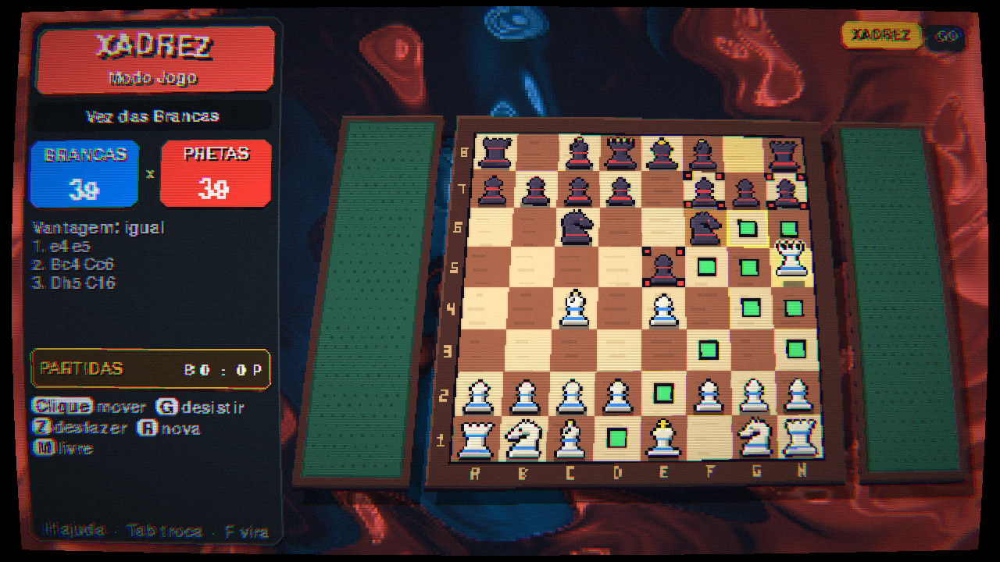
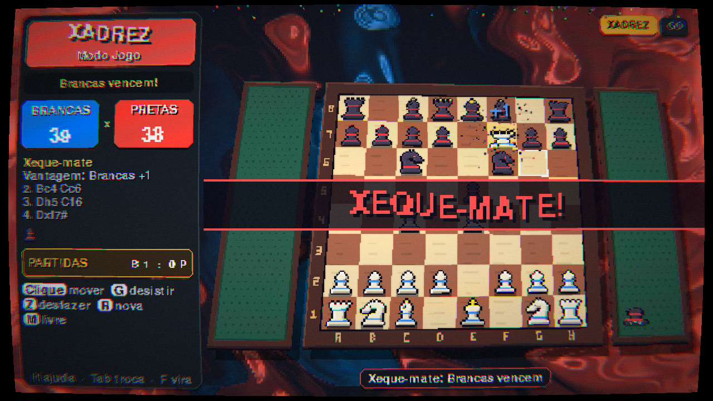
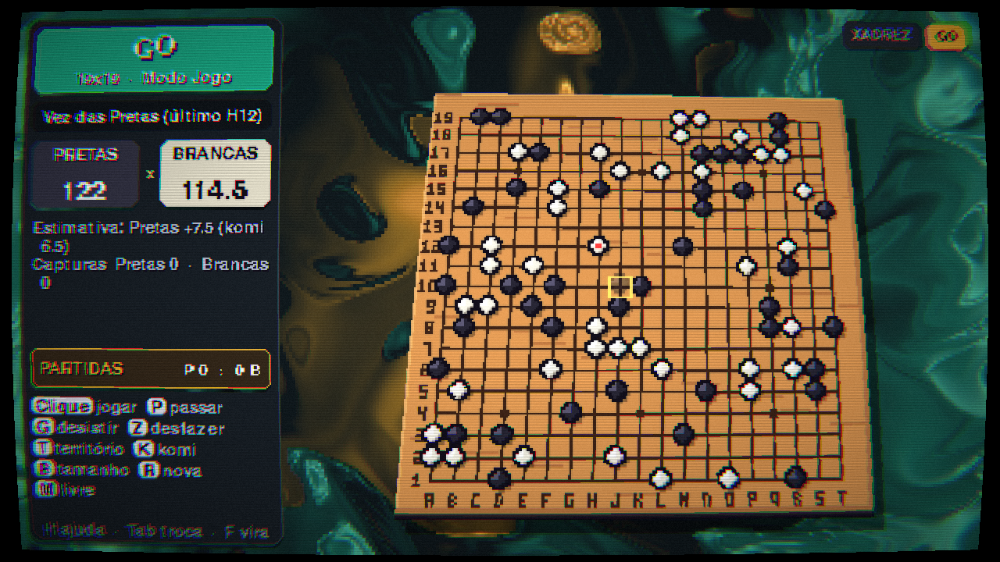
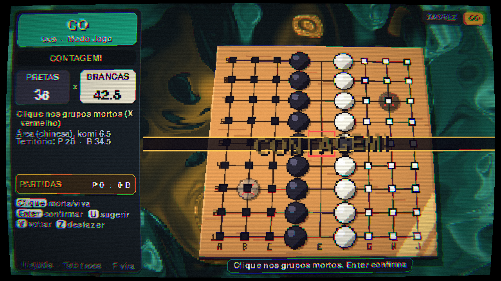

# Tabletop: Xadrez & Go

Uma mesa de **xadrez** e **Go (goban)** em Python, em **pixel art 2D com efeitos de
shader** no estilo de jogos de cartas como Balatro: o tabuleiro é uma "carta" plana
que inclina em pseudo-3D, sobre um fundo de tinta girando, com tela de monitor CRT.

**Efeitos**
- Fundo animado de tinta em redemoinho (shader), com cores próprias de cada jogo.
- Tabuleiro com inclinação pseudo-3D (perspectiva) que acompanha o mouse, sombra
  projetada, espessura e um brilho tipo *foil* que passa de tempos em tempos.
- Tela CRT: curvatura, scanlines, aberração cromática, brilho, vinheta e granulado.
- Juice: peças com quique ao andar e ao pousar, capturas que explodem em pixels,
  tremida de tela, números "+3" saltando, placar que pula quando muda, faixas
  "XEQUE!" / "XEQUE-MATE!" com letras ondulando, confete, e o tabuleiro vira como
  uma carta ao trocar de jogo ou de lado.

**Modos**
- **Modo Jogo**: regras oficiais (xeque, roque, en passant, promoção, mate,
  afogamento, repetição tripla, regra dos 50 lances, material insuficiente; no Go:
  capturas, ko/superko, proibição de suicídio, passes e contagem).
- **Modo Livre**: use o tabuleiro como um tabuleiro de verdade: pegue qualquer
  peça (ela balança na mão como uma carta arrastada), coloque onde quiser, inclusive
  nas bandejas ao lado, crie peças novas, ponha e tire pedras de Go sem regras.
  Depois, **Enter** começa uma partida a partir da posição montada.

**Pontuação automática**
- Xadrez: material de cada lado (P=1, C=3, B=3, T=5, D=9), vantagem, peças
  capturadas, resultado detectado sozinho e **placar de partidas** (vitória = 1,
  empate = ½).
- Go: capturas, **estimativa ao vivo** e, ao fim (dois passes), contagem por
  **área (chinesa)** e por **território (japonesa)** com komi. As pedras mortas são
  sugeridas automaticamente e você ajusta com cliques.






## Instalação

Requer Python 3.9+ e suporte a OpenGL 3.3.

```bash
python -m venv .venv
source .venv/bin/activate        # Windows: .venv\Scripts\activate
pip install -r requirements.txt
python main.py                   # começa no xadrez
python main.py --jogo go         # começa no Go
```

## Controles

### Visão
| Ação | Comando |
|---|---|
| Inclinar o tabuleiro | botão direito + arrastar |
| Deslocar | botão do meio + arrastar, ou `Shift` + botão direito |
| Zoom | roda do mouse |
| Virar o tabuleiro (ver do lado das pretas) | `F` |
| Visão padrão | `Espaço` |

### Geral
| Ação | Tecla |
|---|---|
| Alternar Xadrez / Go | `Tab` (ou clique nas abas no topo) |
| Alternar Modo Jogo / Modo Livre | `M` |
| Desfazer | `Z` |
| Nova partida / reiniciar | `R` |
| Ligar/desligar efeito CRT | `F2` |
| Screenshot (pasta `screenshots/`) | `F12` |
| Ajuda na tela | `H` |
| Sair | `Ctrl+Q` ou fechar a janela |

### Xadrez
- **Modo Jogo**: clique numa peça (os lances legais aparecem em verde, capturas em
  vermelho) e depois no destino. `G` desiste. Na promoção: `1` Dama, `2` Torre,
  `3` Bispo, `4` Cavalo.
- **Modo Livre**: clique para pegar e soltar peças em qualquer casa ou nas bandejas
  laterais (clicar numa casa ocupada troca as peças). `1`–`6` criam uma peça nova
  (peão, cavalo, bispo, torre, dama, rei; com `Shift` ela é preta), `C` troca a cor
  da peça na mão, `Del` descarta, `X` esvazia o tabuleiro (todas as peças vão para as
  bandejas), `R` volta à posição inicial. `Enter` inicia uma partida com as brancas
  jogando (`Shift+Enter`: pretas começam).

### Go
- **Modo Jogo**: clique para jogar (a pedra fantasma mostra se o ponto é legal).
  `P` passa, `G` desiste, `K` muda o komi (0.5 / 5.5 / 6.5 / 7.5), `B` muda o
  tamanho (9×9, 13×13, 19×19), `T` mostra o território estimado.
- **Contagem**: após dois passes seguidos, as pedras mortas são marcadas
  automaticamente (em vermelho). Clique num grupo para alternar morto/vivo, `U`
  refaz a sugestão automática, `V` volta a jogar e `Enter` confirma o resultado.
- **Modo Livre**: clique coloca uma pedra (cor atual, `C` troca, `Shift` usa a outra
  cor) ou remove uma pedra existente. `R` limpa o goban. `Enter` inicia uma partida
  a partir da posição.

## Treino de posições

Os dois jogos têm um **modo de criação livre** (`M`) separado da partida: o que
você monta não estraga a partida em andamento, e `M` de novo volta para ela.

| Ação | Tecla |
|---|---|
| Começar a jogar da posição montada | `Enter` (com `Shift`, o outro lado começa) |
| Voltar / avançar lances (navegar pela partida) | `Z` / `Y` |
| Recomeçar da posição montada | `R` (`Shift+R`: posição padrão / goban vazio) |
| Copiar posição: FEN (xadrez) ou SGF (Go) | `Ctrl+C` |
| Copiar a partida inteira em PGN (xadrez) | `Ctrl+Shift+C` |
| Colar FEN, PGN ou SGF (de sites como Lichess, OGS, etc.) | `Ctrl+V` |
| Salvar a posição atual na sua coleção | `Ctrl+S` (vai para `posicoes/xadrez.txt` ou `posicoes/go.txt`) |
| Carregar a próxima posição salva | `Ctrl+L` |
| Handicap no Go (2 a 9 pedras) | `D`, antes da primeira jogada |

Ao colar um PGN ou SGF, a partida carrega **no começo**: use `Y` para avançar
lance a lance e `Z` para voltar. Uma FEN incompleta (sem os dois reis, por
exemplo) abre no modo livre para você terminar de montar. Se a área de
transferência não funcionar no seu sistema, o texto copiado também fica em
`posicoes/copiado.txt`, e você pode colar escrevendo em `posicoes/colar.txt`.

## Regras implementadas

**Xadrez**: movimentos de todas as peças, xeque (não dá para deixar o rei em
xeque), roque grande e pequeno (sem estar em xeque, sem passar por casa atacada,
direitos perdidos ao mover/perder rei ou torre), en passant (só no lance seguinte,
inclusive com cravada horizontal), promoção para dama/torre/bispo/cavalo,
xeque-mate, afogamento, material insuficiente, repetição tripla, regra dos 50
lances e desistência. O gerador de lances é validado por *perft* nas posições de
referência. Empates por repetição e 50 lances são aplicados automaticamente (sem
precisar reivindicar).

**Go**: captura, proibição de suicídio, ko (superko posicional: nenhuma posição
pode se repetir), passe, fim por dois passes, desistência, komi, handicap com os
pontos tradicionais (brancas começam). Contagem por área (chinesa: pedras +
território + komi, e 1 ponto por pedra de handicap para as brancas) e por
território (japonesa: território + prisioneiros + komi). Pontos neutros (dame) não
contam para ninguém. Na contagem, as pedras mortas são sugeridas automaticamente
e você corrige com cliques.

## Como funciona

```
main.py                  ponto de entrada
tabletop/
  app.py                 janela, entrada, inclinação do tabuleiro, HUD lateral
  gfx.py                 shaders: fundo em redemoinho, tabuleiro em perspectiva,
                         pós-processamento CRT; mapeamento mouse -> tabuleiro
  pixelart.py            sprites das peças/pedras gerados por código + fonte 3x5
  fx.py                  partículas, textos saltando, tremida, easing
  chess_rules.py         regras completas de xadrez (sem dependências)
  go_rules.py            regras de Go, contagem e sugestão de pedras mortas
  storage.py             área de transferência e posições salvas
  chess_scene.py         mesa de xadrez (modos Jogo/Livre, animações, placar)
  go_scene.py            mesa de Go (modos Jogo/Livre, contagem, placar)
tests/                   testes das regras (perft do xadrez, capturas/ko/contagem do Go)
```

Tudo é 2D: o tabuleiro é desenhado em pixel art numa textura pequena, que vira
um quadrilátero em perspectiva (a "carta"). A cena inteira é composta num canvas
de 360 px de altura e ampliada sem suavização, passando pelo shader de CRT. Para
clicar, a posição do mouse desfaz a curvatura do CRT e a perspectiva (homografia)
até chegar à casa do tabuleiro.

## Testes

```bash
pip install pytest
python -m pytest
```
